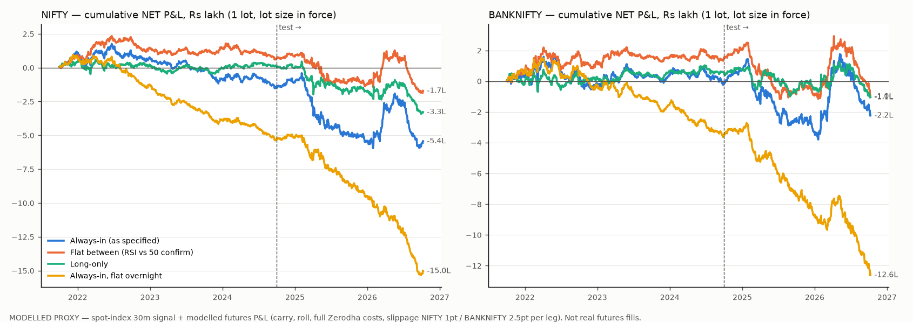

# R72: RSI(10) / WMA(20)-of-RSI crossover, 30-minute bars, 1 lot of index futures

> **MODELLED PROXY. These are not real futures fills.** No 5-year intraday futures
> history exists anywhere we can reach. Kite serves intraday bars only for contracts that
> are still trading, and `continuous=1` returns daily bars only. Historify holds no NFO
> futures bars. So the signal and prices here are **NSE spot-index 30m bars** (Kite,
> 2021-06 → 2026-10). Futures P&L is **modelled** from them: fair basis, a calibrated
> carry, a roll round trip at every monthly expiry, full Zerodha costs and stated
> slippage. Issue [#761](https://github.com/sonawanedhiraj/openalgo/issues/761).

**Verdict: REJECT.** The crossover has a small **gross** edge on both indices: NIFTY
+₹7.4L and BANKNIFTY +₹11.3L over 5 years at the lot size in force. Costs are larger
than that edge. The as-specified always-in strategy loses **₹5.44L net on NIFTY** and
₹2.24L on BANKNIFTY. It loses in the test period on both indices, in all four variants,
and at every point of a 3×3 parameter neighbourhood. Even at **zero slippage** the
NIFTY primary loses ₹2.5L, and the test period is negative on both indices. Under
today's cost schedule (futures STT 0.05% since 2026-04-01) every variant loses more
than ₹5.7L.

## 1. What was tested

| Item | Choice |
|---|---|
| Indicator | RSI length **10** (Wilder/RMA, the TradingView default) on 30m closes. WMA length **20** (linear weights 1..20) of that RSI series. Both counted in **bars**, per the operator ("length only"). |
| Signal | RSI > WMA (the WMA is below the RSI) → long. RSI < WMA → short. Evaluated at each 30m bar **close**. |
| Execution | At the **open of the next bar**, so there is no look-ahead. A signal on the 15:15 bar executes at the next day's 09:15 open, so the overnight gap is included. |
| Primary variant | **always_in**: always long or short, flipping on every cross (as specified). |
| Comparators | **flat_between**: long only if RSI > WMA **and** RSI > 50; short only if RSI < WMA **and** RSI < 50; otherwise flat. **long_only**: long when RSI > WMA, otherwise flat. Extra row **intraday_flat**: the always-in signal, but flat at every close (no overnight, no carry, no roll). |
| Instruments | **NIFTY** futures (primary). **BANKNIFTY** futures (secondary). Stock futures were not run: there is no pre-2024 lot-size table, and a modelled result on a guessed contract spec would mean nothing. |
| Period | 2021-10-01 → 2026-10-09: 1,246 trading days, 16,127 bars, with RSI/WMA warm-up from 2021-06. |
| Split | Chronological. **Train** 2021-10-01 → 2024-09-30 (3 y), **test** 2024-10-01 → 2026-10-09 (2 y). No parameter was fitted, so the split asks one question: does the result hold in a later regime? |
| Size | 1 lot. Two versions: the **lot size actually in force** for each contract, and a **fixed 65** (NIFTY) / **30** (BANKNIFTY), today's lots. |

## 2. How futures P&L is modelled

- **Futures price** = spot × (1 + c × days-to-expiry / 365) for the contract held. P&L
  per bar = position × lot × Δ(modelled futures price). A long therefore pays carry as
  the basis decays to zero, and a short earns it, including over nights and weekends.
- **Carry c, calibrated from real futures-vs-index bars.** Every 30m bar of the Oct, Nov
  and Dec 2026 contracts was matched to the index bar at the same timestamp, between
  2026-07-29 and 2026-10-09, excluding bars within 5 days of expiry:
  - **NIFTY: 6.32%/yr** (ordinary least squares through the origin; median 6.31%,
    middle-50% range 5.69–6.82%, n = 1,157 bars).
  - **BANKNIFTY: 7.38%/yr** (median 7.63%).
  - Sensitivity at ×0.5, ×1.5 and ×0 is in §5. It matters only for long_only; always-in
    is roughly balanced long/short, so carry nets out.
- **Rolls.** The position rolls at the open of the 15:15 bar on each monthly expiry day,
  as two extra legs with full costs and slippage.
  - The expiry calendar is approximated as the last Thursday through Aug-2025 and the
    last Tuesday from Sep-2025, moved to the previous trading day for holidays.
  - BANKNIFTY uses the same calendar. Its real monthly expiry sat on a Wednesday for part
    of 2023-24; the 1–2 day error does not change the roll count or the costs
    materially.
- **Lot size in force**, assigned by the expiry of the contract held. Verified against
  the NSE circulars and broker notices:

  | | Lot sizes by contract expiry |
  |---|---|
  | **NIFTY** | **50** to the Apr-2024 expiry (cut from 75 from the Jul-2021 contracts) → **25** May-2024 → Jan-2025 → **75** Feb-2025 → Dec-2025 (SEBI contract-size rules) → **65** from Jan-2026 (NSE/FAOP/70616) |
  | **BANKNIFTY** | **25** → Jun-2023, **15** Jul-2023 → Jan-2025, **30** Feb → Jun-2025, **35** Jul → Dec-2025, **30** from Jan-2026 |

  The operator brief remembered the NIFTY sequence as "75 → 25 → 75 → 65". The sequence
  in force over this window was 50 → 25 → 75 → 65.
- **Costs per leg, at the schedule in force on the trade date:**
  - brokerage min(₹20, 0.03%)
  - NSE transaction 0.0019% (0.00173% from 2024-10-01)
  - SEBI ₹10/crore
  - stamp 0.002% on the buy side
  - GST 18% on brokerage + transaction + SEBI
  - **STT on the sell side: 0.01% → 0.0125% (2023-04-01) → 0.02% (2024-10-01) →
    0.05% (2026-04-01, Budget 2026)**

  A flip is costed as two legs (close + open). §5 also re-runs the whole period at
  today's schedule.
- **Slippage (explicit assumption): NIFTY 1.0 index point per leg, BANKNIFTY 2.5 points
  per leg**, about 0.004–0.005% of price, i.e. a few ticks on the most liquid futures in
  India. §5 shows zero slippage (the upper bound) and 2×.

## 3. Headline: NIFTY, always-in (as specified)

| Lot mode | Period | Trades | Win % | Gross ₹ | Costs ₹ | **Net ₹** | Payoff | Max DD ₹ | Sharpe |
|---|---|---:|---:|---:|---:|---:|---:|---:|---:|
| in force | **all** | 2,690 | 29.5 | +7,35,444 | 12,79,688 | **−5,44,244** | 2.17 | −7,71,585 | −0.64 |
| in force | train | 1,579 | 30.1 | +3,39,999 | 4,78,033 | −1,38,034 | 2.20 | −3,29,278 | −0.37 |
| in force | test | 1,111 | 28.6 | +3,95,444 | 8,01,655 | −4,06,210 | 2.18 | −5,54,985 | −0.91 |
| fixed 65 | **all** | 2,690 | 29.6 | +10,08,622 | 14,66,553 | **−4,57,931** | 2.22 | −7,43,015 | −0.46 |
| fixed 65 | train | 1,579 | 30.3 | +4,26,109 | 6,52,241 | −2,26,132 | 2.16 | −4,99,804 | −0.42 |
| fixed 65 | test | 1,111 | 28.6 | +5,82,513 | 8,14,312 | −2,31,799 | 2.32 | −4,90,505 | −0.52 |

- **The edge per trade is smaller than the cost per trade.** In-force lots: gross
  ₹273/trade against costs of ₹476/trade. In the test period it is ₹356 against ₹722,
  because the lot tripled to 75 and STT went to 0.02% and then 0.05%.
- **Holding periods are short.** About 540 flips a year means a position is held for
  about 6 bars (3 hours).
- **Win rate is about 30% with a payoff of about 2.2.** That is the usual trend-follow
  shape, but the net expectancy is negative.

**Long vs short (NIFTY, always-in, in-force lots)**

| Period | Long trades / win % / net ₹ | Short trades / win % / net ₹ |
|---|---|---|
| all | 1,345 / 28.8 / −3,28,804 | 1,345 / 30.1 / −2,15,440 |
| train | 789 / 30.5 / +15,985 | 790 / 29.6 / −1,54,019 |
| test | 556 / 26.4 / −3,44,789 | 555 / 30.8 / −61,421 |

The sides swap places. Longs carried train (barely positive) and collapsed in test.
Shorts lost in train and came close to breakeven in test (+₹94,758 at the fixed 65
lot). Neither side holds up in both periods.

## 4. Variants side by side (lot size in force)

**NIFTY**

| Variant | All: trades / gross / net / Sharpe | Train net | Test net | Max DD |
|---|---|---:|---:|---:|
| always_in (spec) | 2,690 / +7.35L / **−5.44L** / −0.64 | −1.38L | −4.06L | −7.72L |
| flat_between | 2,209 / +8.70L / **−1.72L** / −0.25 | **+0.69L** | −2.41L | −4.22L |
| long_only | 1,345 / +3.11L / **−3.29L** / −0.51 | +0.16L | −3.45L | −4.03L |
| intraday_flat | 3,789 / +2.76L / **−15.04L** / −2.35 | −5.27L | −9.77L | −16.30L |

**BANKNIFTY**

| Variant | All: trades / gross / net / Sharpe | Train net | Test net | Max DD |
|---|---|---:|---:|---:|
| always_in (spec) | 2,724 / +11.28L / **−2.24L** / −0.22 | −0.07L | −2.18L | −5.47L |
| flat_between | 2,277 / +10.25L / **−1.00L** / −0.12 | **+1.48L** | −2.49L | −3.94L |
| long_only | 1,362 / +5.71L / **−1.05L** / −0.15 | +0.57L | −1.62L | −2.31L |
| intraday_flat | 3,812 / +6.10L / **−12.61L** / −1.64 | −3.48L | −9.13L | −14.12L |

At the fixed lot, BANKNIFTY flat_between is the only all-period net positive
(+₹51,589). It comes entirely from train (+₹1.91L), and test is −₹1.39L.

**Answer to "always-in or not":**
- Not being always-in helps: flat_between loses about a third of what always-in loses.
- None of the three is profitable out of sample.
- Going flat **overnight** is clearly worst: it adds a round trip every day, and the
  intraday-only gross is small. Most of the gross edge comes from holding through the
  close.



## 5. Sensitivity (lot size in force; values are net ₹, all period [train / test])

| Case | NIFTY always_in | NIFTY flat_between | NIFTY long_only | BANKNIFTY always_in | BANKNIFTY flat_between |
|---|---|---|---|---|---|
| base (1 pt / 2.5 pt slippage) | −5.44L [−1.38 / −4.06] | −1.72L [+0.69 / −2.41] | −3.29L [+0.16 / −3.45] | −2.24L [−0.07 / −2.18] | −1.00L [+1.48 / −2.49] |
| **slippage 0 (upper bound)** | −2.52L [+0.10 / −2.62] | +0.67L [+1.91 / −1.25] | −1.83L [+0.90 / −2.73] | +1.09L [+1.65 / −0.55] | +1.77L [+2.91 / −1.13] |
| slippage ×2 | −8.36L | −4.11L | −4.75L | −5.58L | −3.78L |
| carry ×0.5 | −5.41L | −1.68L | −2.37L | −2.27L | −0.95L |
| carry ×1.5 | −5.47L | −1.76L | −4.21L | −2.22L | −1.05L |
| carry 0 | −5.38L | −1.64L | −1.45L | −2.29L | −0.90L |
| today's cost schedule throughout | −14.73L | −9.31L | −7.93L | −11.63L | −8.79L |
| today's schedule + slippage 0 | −11.81L | −6.93L | −6.47L | −8.29L | −6.01L |

- **Slippage does not explain the loss away.** With zero slippage some all-period
  totals turn positive (BANKNIFTY always_in +₹1.09L, flat_between +₹1.77L; NIFTY
  flat_between +₹0.67L). But every **test** column is still negative.
- **STT is now the dominant cost.** At 0.05%, STT alone on a ₹15L notional is ₹750 per
  flip, about twice the gross edge per trade. Nothing here survives today's schedule,
  even with free execution.
- **Carry hardly matters for always-in** (±₹6k across ×0.5 → ×1.5), because the
  position is long about half the time. For long_only the full carry costs about ₹1.8L over the 5 years.

## 6. Parameter neighbourhood (always-in, fixed lot, net ₹)

The question here is whether 10/20 is a lucky point or whether some nearby setting works
out of sample.

| RSI / WMA | NIFTY train net | NIFTY test net | NIFTY test net, slip 0 | BANKNIFTY train net | BANKNIFTY test net | BANKNIFTY test net, slip 0 |
|---|---:|---:|---:|---:|---:|---:|
| 7 / 10 | −5,30,361 | −8,40,454 | −6,40,709 | −2,74,740 | −6,81,830 | −4,36,805 |
| 7 / 20 | −1,93,515 | −4,63,528 | −3,01,873 | +17,472 | −2,36,449 | −49,174 |
| 7 / 30 | −1,32,766 | −3,26,484 | −1,82,769 | +58,407 | −1,43,461 | +24,014 |
| 10 / 10 | −5,39,150 | −7,52,771 | −5,61,866 | −1,52,865 | −4,72,905 | −2,40,030 |
| **10 / 20** | −2,26,132 | −2,31,799 | −84,834 | −17,988 | −49,644 | +1,18,431 |
| 10 / 30 | **+1,60,445** | −1,81,662 | −57,707 | **+1,62,045** | −1,53,499 | −8,824 |
| 14 / 10 | −5,12,858 | −5,93,240 | −4,10,395 | −62,339 | −4,82,315 | −2,60,240 |
| 14 / 20 | −92,328 | −1,40,385 | −8,500 | +90,946 | −51,905 | +1,00,570 |
| 14 / 30 | +38,070 | −87,371 | +23,324 | −1,00,839 | −85,775 | +50,350 |

- **All 18 test cells are negative at the stated slippage.**
- Slower settings (longer WMA, fewer trades) lose less, because cost scales with the
  number of flips. The best train cell (10/30) is negative in test on both indices.
- The only positive test cells appear at **zero** slippage.

## 7. Spot proxy vs real futures (2026-07-29 → 10-09 overlap, ~630 bars)

Spot index bars can show momentum that futures don't, because index constituents print
at different moments and the index lags.

- **Autocorrelation.** Same-day lag-1 autocorrelation of 30m returns is small: NIFTY
  spot +0.013 over 5 years, +0.077 spot vs +0.026 futures in the overlap.
- **Signal on the real contract.** Run on the Oct-2026 contract's own bars, the NIFTY
  signal made 2.9 points gross per flip, against 2.4 on spot.
- **BANKNIFTY** lost gross on both (−9 points/flip on spot, −41 on futures). The sample
  covers about 120 flips.

The window is far too short to calibrate a spot-to-futures haircut. It is at least
consistent with the spot proxy **not** understating the futures result for NIFTY. Since
the verdict is a reject on costs, any remaining spot bias could only make the real
result worse.

## 8. Margin for 1 lot vs the account

| | Today (Kite margin calculator, NRML, 2026-10-09) | Historic estimate (11.2% of notional, today's ratio) |
|---|---|---|
| NIFTY 1 lot (65) | **₹1,64,713** (SPAN ₹1,35,301 + exposure ₹29,413) on ~₹14.7L notional | 2021–23 about ₹0.97–1.06L (lot 50) · 2024 about ₹0.87L (lot 25→75) · 2025 about ₹1.94L (lot 75) |
| BANKNIFTY 1 lot (30) | **₹1,86,441** on ~₹16.7L notional | 2021–23 about ₹0.97–1.06L · 2024 about ₹0.84L · 2025 about ₹1.91L |

**Account capacity.**
- At check time (2026-10-09) the account's available cash covers **one NIFTY lot with
  under ₹20k of headroom**. It does **not** cover one BANKNIFTY lot.
- The strategy's own path could not be carried. The NIFTY always-in **max drawdown of
  ₹7.7L is about 4.7× today's 1-lot margin**, and even flat_between's ₹4.2L is 2.6×.
- An account sized to this cash would have been margin-called and liquidated in the
  first sustained losing stretch (the 2025 leg: −₹4.4L in one calendar year).

## 9. Per year (NIFTY always-in, lot size in force)

| Year | Trades | Win % | Gross ₹ | Costs ₹ | Net ₹ | Long net | Short net |
|---|---:|---:|---:|---:|---:|---:|---:|
| 2021 (Oct–Dec) | 127 | 38.6 | +1,36,132 | 38,305 | +97,828 | +40,348 | +57,480 |
| 2022 | 506 | 33.2 | +1,26,677 | 1,50,323 | −23,646 | −20,547 | −3,099 |
| 2023 | 546 | 29.1 | +20,002 | 1,79,679 | −1,59,677 | −20,310 | −1,39,367 |
| 2024 | 535 | 26.4 | +1,23,405 | 1,45,347 | −21,943 | +113 | −22,055 |
| 2025 | 571 | 27.7 | −58,062 | 3,81,054 | −4,39,116 | −1,70,106 | −2,69,011 |
| 2026 (to Oct-09) | 405 | 29.1 | +3,87,290 | 3,84,979 | +2,310 | −1,58,302 | +1,60,612 |

**BANKNIFTY always-in, lot size in force** (net ₹):
2021 +33,186 · 2022 −62,971 · 2023 +68,582 · 2024 +31,572 · 2025 −4,09,107 · 2026 +1,14,418.

- **Gross is positive in 5 of 6 years** on NIFTY. The edge is real but thin, and
  2025's choppy tape erased it on both indices.
- **Net is positive only in the 3-month 2021 stub** (plus breakeven in 2026). Every full
  year is negative on NIFTY.
- BANKNIFTY had three small positive years (2021, 2023, 2024) on the old low-STT
  schedule and a −₹4.1L 2025.

The other variants' per-year tables are in `backtest/rsi_wma_r72/results.json`.

## 10. Verdict

**Does it have an edge?** A small **gross** one. The RSI(10)-vs-WMA(20) state on 30m
index bars predicts the next few hours slightly better than a coin flip in the payoff
sense (win rate about 30%, payoff about 2.2). It made +₹7.4L (NIFTY) and +₹11.3L
(BANKNIFTY) gross over 5 years at 1 lot.

**Is any of it robust out of sample?** **No.**
- Net of costs, the as-specified strategy loses on both indices in both periods (except
  BANKNIFTY train at −₹6.6k, which is flat).
- Every variant is negative in the 2024-10 → 2026-10 test period.
- Every point of the 3×3 parameter neighbourhood is negative in test.
- The only positive numbers need train-only selection, zero slippage, or both.

**Why it fails: turnover.** About 540 flips a year times about ₹475 per round trip
(₹720 in the test period) costs more than the about ₹270–360 gross each trade earns.
With STT at 0.05% since April 2026 the gap has more than doubled. A strategy on this
signal would need to trade far less often to have a chance, e.g. a daily-bar version or
a much longer WMA, and that is a different strategy.

**Not recommended for live or sandbox deployment.** It also could not be carried on the
current account: max drawdown is 4–5× the 1-lot margin.

## Reproduce

```
uv run python backtest/rsi_wma_r72/fetch.py              # needs OpenAlgo running + broker session
cd backtest/rsi_wma_r72 && uv run --with matplotlib python report.py   # -> results.json + equity PNG
```

The scripts and parquet cache live in `backtest/rsi_wma_r72/` (not tracked, like other
rounds' working dirs).

Sources for the contract specs and taxes: NSE circulars NSE/FAOP/70616 (Oct-2025) and
NSE/FAOP/56233 (Mar-2023); Zerodha Z-Connect "Revision in lot size of index derivative
contracts from April 26, 2024"; Zerodha bulletin on the Jul-2021 NIFTY lot size of 50;
Budget 2026 STT change (futures 0.02% → 0.05% from 2026-04-01). Kite Connect historical
docs: `continuous` is daily-only.
