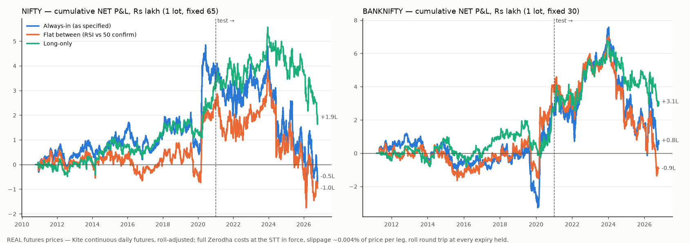

# R73: RSI(10) / WMA(20)-of-RSI crossover, DAILY bars, 1 lot of index futures

> **This is a backtest on REAL futures prices, unlike R72.** R72 (30-minute bars) had to be a
> modelled proxy: spot-index signal plus modelled carry, because Kite serves intraday bars only
> for contracts still trading. Kite's `continuous=1` flag does serve **daily** bars for expired
> futures, stitched month to month. R73 uses those real NIFTY and BANKNIFTY futures prices, with
> carry already inside them. Do not mix R72's numbers up with these.
> Issue [#768](https://github.com/sonawanedhiraj/openalgo/issues/768). Follows R72
> ([#761](https://github.com/sonawanedhiraj/openalgo/issues/761),
> `2026-10-11_r72_rsi10_wma20_30m_index_futures.md`).

**Verdict: REJECT.**
- **Moving to daily bars cuts turnover 12×, but the edge per trade does not close the gap. On
  the same 5-year window as R72 it disappears.**
  - NIFTY, 2021-10 → 2026-10, lot size in force: daily gross is **−₹354 per trade** against
    ₹572 of cost, at 44 trades a year. R72 on 30m bars over the same window: +₹273 gross
    against ₹476 cost, at 540 trades a year.
  - The daily version loses less (−₹2.05L against R72's −₹5.44L) only because it trades 12×
    less often.
- **Over the full 16 years of real futures**, NIFTY always-in finishes at **+₹10,800 net**:
  gross ₹349 per trade against ₹333 cost. That is breakeven.
  - All of it comes from **one year**: 2020 made +₹3.44L.
  - Without 2020 it is −₹3.33L.
- **Every variant is negative in the 2021 → 2026 test period** on NIFTY.
- **Statistical strength:** no variant reaches t = 2 on either index, in any period.
- **Survivability:** a 1-lot NIFTY account needed about ₹2.9L to never be margin-called if it
  started in 2010, and about ₹5.3–5.8L if it started in 2021. One lot's margin is about ₹1.66L.

## 1. Data: what was used and how far back

| Item | Detail |
|---|---|
| **Futures (real)** | Kite historical `day` candles with `continuous=1` on the live front-month token. **NIFTY 2010-10-14 → 2026-10-13 (3,966 days, 16.0 y)**. **BANKNIFTY 2011-03-08 → 2026-10-13 (3,867 days, 15.6 y)**. The OpenAlgo Zerodha adapter never passes `continuous`, so the scratch fetch script calls the endpoint through the adapter's own request helper. There is no adapter or engine change. |
| **Spot index** | Kite daily from 2000. Used only to back-adjust the stitch (below) and to price the roll legs. |
| **Cross-check** | Kite spot daily against historify daily from 2022 (1,177 days): 1,166 match to within 0.01%. 11 days differ by up to 0.7% (NIFTY) / 1.5% (BANKNIFTY). Those look like historify's known provisional-intraday-close days (#277). Historify holds no futures, so the futures series has no second source. |
| **Roll handling** | Kite stitches the raw front month. On the first day of each new contract the series jumps by that contract's premium over spot, a median of +0.40% (NIFTY) and +0.44% (BANKNIFTY). Left in, that jump would be counted as fake profit for longs. The series is therefore **difference back-adjusted**: the gap is the new contract's observed basis applied to the prior day's spot close. P&L in points is the change in the adjusted series. |
| **Roll dates** | Detected from the data: the day the raw basis jumps the most in each month's last 10 days. They agree with the last-Thursday/Tuesday calendar on 145/192 NIFTY months. Kite's older stitch often switches a day off the calendar, and that day is where the jump actually sits. A calendar-roll re-run is in §5 (NIFTY −₹43k vs −₹49k). Check: the adjusted series carries **5.2%/yr (NIFTY) and 5.8%/yr (BANKNIFTY)** of carry below spot buy-and-hold, close to the R72 calibration (6.3% / 7.4%). |

**Sample size.** Daily flips are about **43 a year** (average hold 5.7 trading days):
- NIFTY full history: **688 trades**. Train (2010-10 → 2020-12): 428. Test (2021-01 → 2026-10): 260.
- BANKNIFTY with verified lot sizes: 349 (from 2018-11).

At these per-trade P&L spreads, about 260 test trades put a t-stat near ±1 even at the full
gross effect, so the test cell is **thin**. The train/test **sign flip** is clear; the size of
the test loss is not precise.

## 2. What was tested (identical to R72 except the bar size)

| Item | Choice |
|---|---|
| Signal | RSI length **10** (Wilder) on daily futures closes. WMA length **20** of the RSI. RSI > WMA → long, RSI < WMA → short. Evaluated at the close. |
| Execution | **Next day's open** (no look-ahead). Positions held through expiry roll at the expiry-day close, as two extra legs with full costs. |
| Variants | **always_in** (spec); **flat_between** (long only if RSI > 50 as well, short only if RSI < 50, else flat); **long_only**. |
| Lots | **In force**, and **fixed 65 / 30** (today's lots). |
| NIFTY in-force lots | 25 (to Oct-2015 expiry) → 75 (Nov-2015 → Jun-2021) → 50 (Jul-2021 → Apr-2024) → 25 (May-2024 → Jan-2025) → 75 (Feb-2025 → Dec-2025) → 65 (from Jan-2026). Verified against NSE circulars and Zerodha notices. |
| BANKNIFTY in-force lots | Only the sizes from **Nov-2018** are verified: 20 → 25 (Jul-2020) → 15 (Jul-2023) → 30 (Feb-2025) → 35 (Jul-2025) → 30 (Jan-2026). The 2011–2018 sizes (25/30/40) are not, so in-force BANKNIFTY is reported **from 2018-11 only**. The full 16 years use fixed 30, so no result rests on a guessed contract size. |
| Costs per leg (at the schedule in force) | Brokerage min(₹20, 0.03%); NSE transaction 0.0019% (0.00173% from 2024-10); SEBI ₹10/cr; stamp 0.002% on buys; GST 18%. **STT on sells: 0.017% → 0.01% (2013-06-01) → 0.0125% (2023-04) → 0.02% (2024-10) → 0.05% (2026-04).** |
| Slippage (explicit) | **0.004% of price per leg (NIFTY) / 0.0045% (BANKNIFTY)**. That is about 1 point / 2.5 points at today's levels, the same as R72, expressed as a percentage so it scales across 16 years of prices. Zero slippage is shown as the upper bound. |
| Split | Train 2010/11 → 2020-12-31, test 2021-01-01 → 2026-10-13. Also reported over **R72's exact window** (2021-10-01 → 2026-10-09) for the side-by-side. |

## 3. The question this round was for: does the per-trade gap close?

**NIFTY always-in, lot size in force.**

| | Bars | Window | Trades/yr | Hold | **Gross / trade** | **Cost / trade** | Gap | Net |
|---|---|---|---:|---|---:|---:|---:|---:|
| R72 (proxy) | 30m | 2021-10 → 2026-10 | 536 | ~3 h | **+₹273** | **₹476** | −₹203 | −₹5.44L |
| **R73 (real)** | daily | **same window** | **44** | 5.6 d | **−₹354** | **₹572** | −₹926 | −₹2.05L |
| R73 (real) | daily | full 16 y | 43 | 5.7 d | +₹349 | ₹333 | **+₹16** | +₹0.11L |
| R73 (real) | daily | train 2010–20 | 42 | 5.9 d | +₹969 | ₹207 | +₹762 | +₹3.27L |
| R73 (real) | daily | test 2021–26 | 45 | 5.5 d | −₹672 | ₹542 | −₹1,214 | −₹3.16L |

**Answer: the gap does not close.**
- **Trades per year fell 12× (536 → 44), as expected.**
- **Cost per trade did not fall: it rose to ₹572.** A 5–6 day hold crosses an expiry on 22–24%
  of trades, which adds a roll round trip. Notional per trade is the same lot.
- **Gross per trade did not rise.** On the same 2021–26 window it turned **negative**.
- **Over the full 16 years** gross ≈ cost, i.e. breakeven before any judgement call. 2010–2020
  is positive and 2021–2026 negative.
- **The only thing the daily bar fixes is the trade count.** Losses shrink because there are
  fewer trades, not because any trade got better.

## 4. Results

**NIFTY (real futures, 2010-10 → 2026-10)**

| Variant / lot | Period | Trades | Win % | Gross ₹ | Costs ₹ | **Net ₹** | Payoff | Max DD ₹ | Sharpe |
|---|---|---:|---:|---:|---:|---:|---:|---:|---:|
| always_in · in force | **all** | 688 | 35.2 | +2,40,182 | 2,29,382 | **+10,800** | 1.85 | −5,69,864 | 0.01 |
| | train | 428 | 36.9 | +4,14,939 | 88,393 | +3,26,546 | 2.08 | −1,96,463 | 0.29 |
| | **test** | 260 | 32.3 | −1,74,757 | 1,40,989 | **−3,15,746** | 1.79 | −4,88,031 | −0.29 |
| always_in · fixed 65 | **all** | 688 | 35.5 | +2,08,441 | 2,57,417 | **−48,976** | 1.80 | −6,46,426 | −0.02 |
| | train / test | 428 / 260 | | | | +3,61,969 / **−4,10,945** | | | |
| flat_between · in force | all | 591 | 35.5 | +1,58,891 | 1,88,571 | −29,680 | 1.80 | −4,37,830 | −0.02 |
| | train / test | 374 / 217 | | | | +2,79,677 / **−3,09,358** | | | |
| long_only · in force | all | 344 | 36.6 | +3,29,553 | 1,09,867 | **+2,19,686** | 1.95 | −3,22,052 | 0.17 |
| | train / test | 214 / 130 | | | | +3,30,209 / **−1,10,523** | | | |

**Long vs short (NIFTY always-in, in force):**
- **Longs:** 344 trades, win 36.6%, net **+₹2.20L**.
- **Shorts:** 344 trades, win 33.7%, net **−₹2.09L**.
- In test both lose (longs −₹1.11L, shorts −₹2.05L).
- The long side's full-history gain is mostly the index's upward drift; the short side pays
  that drift back.

**BANKNIFTY (real futures)**

| Variant / lot | Period | Trades | Net ₹ | Notes |
|---|---|---:|---:|---|
| always_in · fixed 30 | all 2011–26 | 692 | +75,505 | train +₹2.63L / **test −₹1.87L**; Sharpe 0.03; MaxDD −₹7.7L |
| always_in · in force | 2018-11 → 2026 | 349 | +1,10,927 | train (2018-11 → 2020) +₹2.19L / **test −₹1.08L** |
| flat_between · fixed | all | 586 | −91,672 | train +₹4.01L / **test −₹4.93L** |
| long_only · fixed | all | 346 | +3,09,033 | train +₹2.90L / test +₹18,890 |

- BANKNIFTY long-only is the only cell positive in test, and only barely (+₹19k at the fixed
  lot, t = 0.05).
- It goes to −₹44k at today's STT, and 2026 alone is −₹1.40L.

**2020 carries everything.**
- NIFTY always-in made +₹3.44L in 2020 (crash then rebound). Full-history net without it:
  **−₹3.33L**. Train without it: −₹18k.
- BANKNIFTY fixed made +₹5.23L in 2020. Without it: **−₹4.47L**.
- Long-only without 2020 is about flat on NIFTY (−₹19k).

**t-stats of mean net per trade** (none reaches 2):

| | full | train | test |
|---|---:|---:|---:|
| NIFTY always-in | 0.02 | 0.81 | −0.84 |
| NIFTY long-only | 0.66 | 1.68 | −0.41 |
| BANKNIFTY always-in (fixed lot) | 0.10 | 0.52 | −0.34 |



## 5. Sensitivity (fixed lot; net ₹, all period [train / test])

| Case | NIFTY always_in | NIFTY flat_between | NIFTY long_only | BANKNIFTY always_in | BANKNIFTY long_only |
|---|---|---|---|---|---|
| base | −49k [+3.62L / −4.11L] | −96k [+2.55L / −3.51L] | +1.91L [+3.36L / −1.45L] | +76k [+2.63L / −1.87L] | +3.09L [+2.90L / +19k] |
| **slippage 0** | +8k [+3.85L / −3.77L] | −49k | +2.19L [/ −1.29L] | +1.42L [/ −1.48L] | +3.42L [/ +38k] |
| slippage ×2 | −1.06L | −1.43L | +1.63L | +9k | +2.76L |
| **today's cost schedule throughout** | −2.91L [/ −5.43L] | −2.95L | +73k [/ −2.08L] | −1.72L [/ −3.18L] | +1.88L [/ −44k] |
| calendar rolls instead of detected | −43k [/ −4.10L] | −93k | +2.36L [/ −1.38L] | +1.20L [/ −1.62L] | +4.43L [/ +87k] |

- Zero slippage turns no NIFTY test column positive.
- At today's 0.05% STT, every always-in and flat_between cell is negative over the full 16
  years.
- How rolls are placed shifts BANKNIFTY by up to ₹1.3L, because its monthly expiry weekday
  changed more than once. It does not change any sign that matters.

## 6. Nearby settings — 3×3 grid on the TEST period (fixed lot, always-in, net ₹)

| RSI / WMA | NIFTY test net | NIFTY test, slip 0 | BANKNIFTY test net | BANKNIFTY test, slip 0 |
|---|---:|---:|---:|---:|
| 7 / 10 | −4,36,817 | −3,93,114 | −3,00,185 | −2,50,118 |
| 7 / 20 | −2,87,785 | −2,49,660 | −41,582 | −189 |
| 7 / 30 | −4,45,453 | −4,08,995 | −1,02,490 | +24,014 |
| 10 / 10 | −4,01,705 | −3,60,093 | **+4,334** | +52,600 |
| **10 / 20** | −4,10,945 | −3,76,762 | −1,87,386 | −1,47,736 |
| 10 / 30 | −2,57,647 | −2,26,322 | −1,11,988 | −76,720 |
| 14 / 10 | −3,13,912 | −2,72,207 | −19,920 | +27,033 |
| 14 / 20 | −3,78,860 | −3,46,285 | −2,25,613 | −1,87,135 |
| 14 / 30 | −2,86,102 | −2,59,161 | −1,53,095 | −1,19,732 |

- **NIFTY: 9 of 9 cells negative in test, at zero slippage too.**
- **BANKNIFTY: 1 of 9 positive** (+₹4k, within noise).
- In **train**, by contrast, every NIFTY cell is positive at the stated slippage except 7/10
  (−₹60k), and slower settings did best (14/30: +₹6.1L).
- That is the in-sample pattern R61/R62 warned about: the parameter set that looks best in
  train is not the one that survives.

## 7. Margin vs drawdown — does a 1-lot account survive?

| | 1-lot margin today (Kite, NRML) | Max drawdown | Min capital never to be margin-called* |
|---|---:|---:|---:|
| NIFTY always-in, in force | ₹1.65L (65 lots) | −₹5.70L | **≈ ₹2.88L** |
| NIFTY always-in, fixed 65 | ₹1.65L | −₹6.46L | ≈ ₹3.48L |
| BANKNIFTY always-in, in force (2018–) | ₹1.86L (30) | −₹5.32L | ≈ ₹2.74L |
| BANKNIFTY always-in, fixed 30 | ₹1.86L | −₹7.73L | ≈ ₹4.32L |

\*Starting capital such that capital plus cumulative P&L always covers the open position's
margin, taken as 11.2% of futures notional (today's Kite SPAN+exposure ratio).

- **Survival on today's account:** the account's available cash at the R72 check (2026-10-09)
  covers one NIFTY lot with less than ₹20k headroom. That is well below the ≈ ₹2.9L this
  strategy needed.
- **The ≈ ₹2.9L figure assumes trading from 2010.** That start banks the 2020 windfall before
  the losses arrive. The bind comes in Feb-2026, after the 2024–26 losses erased it.
- **Started at the test-period start, the requirement is about double:**
  - From 2021-01: min capital ≈ **₹5.8L** in force (≈ ₹6.8L fixed 65).
  - From 2021-10 (R72's window): ≈ ₹5.3L.
- **When today's cash breaches:**
  - From 2021-01: margin call in **May-2021**.
  - From 2021-10: Jan-2025 (in force), Dec-2021 (fixed 65).
- **Verdict on survivability:** a 1-lot account at today's cash does not survive this strategy.
  It holds up better than under R72 (₹7.7L max DD on 30m bars), but the answer is the same.

## 8. Per year (NIFTY always-in, lot size in force; net ₹)

| Year | Trades | Win % | Gross | Costs | **Net** | Long | Short |
|---|---:|---:|---:|---:|---:|---:|---:|
| 2010 (Oct–Dec) | 4 | 25.0 | −6,798 | 471 | −7,269 | −473 | −6,796 |
| 2011 | 45 | 37.8 | +24,411 | 4,920 | +19,491 | −9,988 | +29,479 |
| 2012 | 41 | 39.0 | +4,739 | 4,567 | +172 | +11,435 | −11,263 |
| 2013 | 42 | 40.5 | +5,735 | 4,752 | +982 | −1,721 | +2,703 |
| 2014 | 38 | 26.3 | +8,992 | 4,461 | +4,531 | +21,043 | −16,512 |
| 2015 | 36 | 52.8 | +55,479 | 5,324 | +50,155 | +6,255 | +43,900 |
| 2016 | 56 | 32.1 | −21,188 | 12,646 | −33,834 | −10,663 | −23,171 |
| 2017 | 36 | 50.0 | +21,841 | 10,794 | +11,046 | +75,109 | −64,063 |
| 2018 | 44 | 31.8 | +38,958 | 13,085 | +25,873 | +12,390 | +13,483 |
| 2019 | 42 | 28.6 | −75,215 | 13,507 | −88,722 | −12,254 | −76,468 |
| **2020** | 44 | 36.4 | +3,57,985 | 13,864 | **+3,44,121** | +2,39,075 | +1,05,045 |
| 2021 | 48 | 29.2 | −85,692 | 17,102 | −1,02,793 | +39,763 | −1,42,557 |
| 2022 | 38 | 34.2 | +91,863 | 12,195 | +79,668 | +25,375 | +54,293 |
| 2023 | 47 | 29.8 | +35,955 | 16,241 | +19,714 | +75,452 | −55,739 |
| 2024 | 40 | 30.0 | −1,41,354 | 13,662 | −1,55,017 | −63,955 | −91,062 |
| 2025 | 46 | 37.0 | −54,488 | 36,890 | −91,378 | −6,214 | −85,163 |
| 2026 (to Oct-13) | 41 | 34.1 | −21,042 | 44,899 | −65,940 | −1,80,945 | +1,15,004 |

- Positive in 10 of 17 calendar years, but small except 2020. 2010–2015 lot was 25, so those
  rupee figures are small by construction (see the fixed-lot column in `results.json`).
- Costs per year rose from about ₹5k (2011–15) to about ₹45k (2026). The cause is the lot
  tripling plus STT going 0.01% → 0.05%.
- BANKNIFTY fixed-lot per year: 2019 −₹2.33L, 2020 +₹5.23L, 2022 +₹3.48L, 2023 +₹1.99L, 2024
  **−₹4.65L**, 2025 −₹1.10L, 2026 −₹77k.

## 9. Verdict

- **Does it have an edge?**
  - **Before costs: marginally.** It shows up in 2010–2020, almost entirely in 2020, and it is
    gone in 2021–2026.
  - **After costs: no.** NIFTY over 16 years nets about breakeven (+₹10,800) with t = 0.02;
    without 2020 it is −₹3.3L.
- **Is any of it robust out of sample?** **No.**
  - Every NIFTY variant and all 9 NIFTY grid cells lose in the 2021–2026 test, with zero
    slippage too.
  - The one BANKNIFTY cell positive in test (long-only, +₹19k) is t = 0.05 and turns negative
    at today's STT.
- **Did daily bars close R72's per-trade gap?** **No.**
  - Turnover fell 12×, which cut the loss, but gross per trade did not rise.
  - On the same 5-year window it went from +₹273 (R72, proxy) to −₹354 (R73, real), and cost
    per trade rose to ₹572 because 5-day holds pay rolls.
- **Is the sample enough?** For the reject, yes: 688 trades over 16 years, a train/test sign
  flip on both indices and in every variant, and no t-stat near 2 anywhere. The test cell alone
  (260 trades) is too thin to size the loss precisely.
- **Survivability:** a 1-lot NIFTY account needed about ₹2.9L to avoid a margin call if it
  started in 2010, and about ₹5.3–5.8L if it started in 2021. That is 1.7–3.5× the lot's
  margin, and today's cash would have been margin-called.
- **Recommendation:** not for live or sandbox. Long-only is really index beta (long the drift),
  which a plain buy-and-hold carries without the 22 round trips a year.

## Reproduce

```
uv run python backtest/rsi_wma_r73/fetch.py               # needs OpenAlgo DB + live broker session (read-only)
cd backtest/rsi_wma_r73 && uv run --with matplotlib python report.py   # -> results.json + equity PNG
```

The scripts and parquet cache are in `backtest/rsi_wma_r73/` (untracked, like R72's).

Sources:
- Kite Connect historical API (`continuous` returns daily bars only).
- NSE circulars NSE/FAOP/70616 (2025), NSE/FAOP/56233 (2023), NSE/FAOP/39012 (2018).
- Zerodha notices on NIFTY lots (25 2010–2015, 50 from Jul-2021, 25 from Apr-2024) and on
  BANKNIFTY lots (40→20 in 2018, 20→25 in 2020).
- STT history: 0.017% → 0.01% from 2013-06-01 (Finance Act 2013); 0.0125% (2023);
  0.02% (Oct-2024); 0.05% (Apr-2026, Budget 2026).
